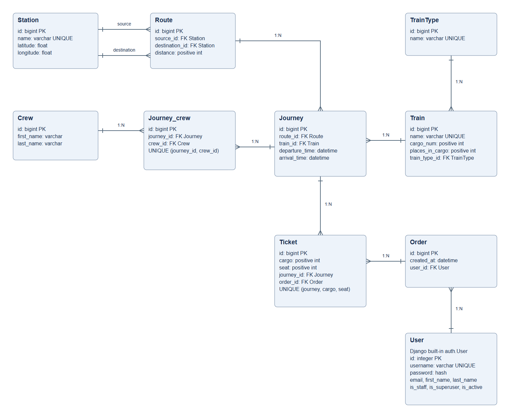
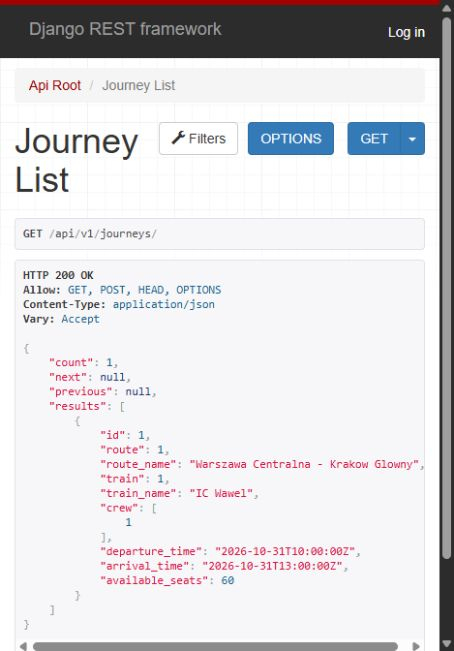
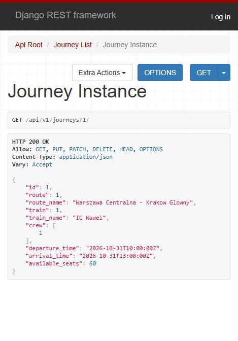
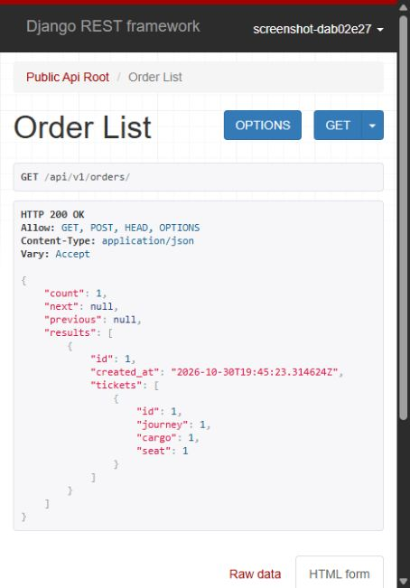
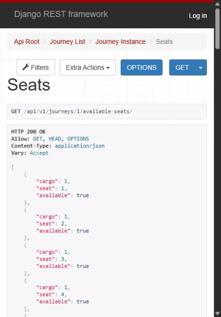
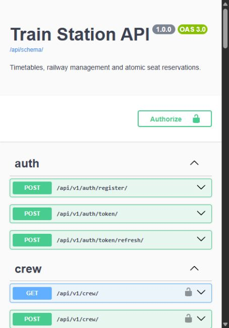

# Train Station API

REST API for railway timetables and seat reservations, built with Django REST
Framework and PostgreSQL. Travelers can browse upcoming journeys and book tickets.
Staff manage stations, routes, trains, crew and the timetable.

## Features

- Registration and JWT authentication.
- Journey filters by departure station, destination, date, route and train.
- Search, ordering and pagination.
- Orders containing multiple tickets, visible only to their owner.
- Transactional reservations with database seat uniqueness.
- Checks for overlapping train and crew assignments.
- Swagger documentation and Django's Browsable API.

## Stack

Python 3.12, Django, Django REST Framework, PostgreSQL 16, Simple JWT,
django-filter and drf-spectacular. Docker runs PostgreSQL and Django's development
server.

## Run locally

Requires Python 3.12 and Docker with Compose.

```sh
git clone https://github.com/kuligambino01/railway-station-api.git
cd railway-station-api
git checkout develop
cp .env.example .env
```

In PowerShell, use `Copy-Item .env.example .env` instead of `cp`.
If `.env` already exists, keep it. Set `DB_PASSWORD` to your own database password
and `SECRET_KEY` to a random value of at least 50 characters. You can generate a
value for each with Python:

```sh
python -c "import secrets; print(secrets.token_urlsafe(50))"
```

Start the application:

```sh
docker compose up --build -d
docker compose exec api python manage.py seed_demo
docker compose exec api python manage.py createsuperuser
```

Migrations run when the container starts. The optional `seed_demo` command creates
sample stations, a train and a journey for tomorrow. You can also add records
through the API using your staff account.

- [Browsable API](http://127.0.0.1:8000/api/v1/)
- [Swagger](http://127.0.0.1:8000/api/docs/)
- [OpenAPI schema](http://127.0.0.1:8000/api/schema/)
- [Admin](http://127.0.0.1:8000/admin/)

Use the staff account through the API to manage railway records.
The admin displays railway records read-only.

Stop the containers with `docker compose down`. Data stays in a Docker volume.
Changing `DB_PASSWORD` in `.env` does not update an existing PostgreSQL role.

## Authentication

Register with `POST /api/v1/auth/register/`:

```json
{"username": "traveler", "password": "Choose-your-own-strong-password-42!"}
```

Send the same credentials to `POST /api/v1/auth/token/` to get access and
refresh tokens. Use the access token in protected requests:

```text
Authorization: Bearer <access>
```

Refresh it at `POST /api/v1/auth/token/refresh/` with
`{"refresh": "<refresh>"}`. `GET /api/v1/users/me/` returns your profile.

Swagger supports token authentication through **Authorize**.
The Browsable API also supports session login through **Log in**.

## API

All resource URLs below start with `/api/v1/`.

| Resource | Access |
| --- | --- |
| `stations/`, `routes/`, `train-types/`, `trains/` | Public reads, staff writes |
| `crew/` | Staff only |
| `journeys/` | Public reads, staff writes |
| `journeys/{id}/available-seats/` | Public seat availability |
| `orders/` | Create a reservation or list your orders |
| `orders/{id}/` | Read your own order |

Lists use pagination with 20 records per page. For example:

```text
/api/v1/journeys/?source=1&destination=2&ordering=departure_time
```

Use station IDs from the catalog. The `date` filter accepts `YYYY-MM-DD`.
Timestamps use UTC; submitted timestamps must include `Z` or a UTC offset.
Public journey lists show upcoming departures. Staff can also inspect past
journeys. A departed journey remains accessible by ID but cannot be booked.

## Book tickets

Check the journey's available seats, then send `POST /api/v1/orders/` with
your access token:

```json
{
  "tickets": [
    {"journey": 1, "cargo": 1, "seat": 1},
    {"journey": 1, "cargo": 1, "seat": 2}
  ]
}
```

Use a journey ID from your database. `cargo` means carriage; carriage and seat
numbers start at 1. An order accepts up to 50 tickets.

A successful booking returns HTTP 201. If a requested seat has been booked,
the API returns HTTP 409. Failed reservations save neither the order nor
any of its tickets.

In the Browsable API, submit orders through **Raw data** as `application/json`.

## Tests

```sh
docker compose exec api pytest -q
docker compose exec api ruff check .
docker compose exec api ruff format --check .
docker compose exec api python manage.py makemigrations --check --dry-run
```

Tests cover authentication, permissions, filters, reservation validation,
transaction rollback and concurrent booking and scheduling requests.
GitHub Actions runs the tests against PostgreSQL.

## Run without Docker

Install PostgreSQL and create a database. Prepare `.env` as above and set `DB_NAME`,
`DB_USER`, `DB_PASSWORD`, `DB_HOST` and `DB_PORT` to match your database.

```sh
python -m venv .venv
```

Activate it with `.venv\Scripts\Activate.ps1` on PowerShell or
`source .venv/bin/activate` on macOS/Linux, then run:

```sh
pip install -r requirements-dev.txt
python manage.py migrate
python manage.py createsuperuser
python manage.py runserver
```

Run tests with `pytest -q`. SQLite is available with `DB_ENGINE=sqlite` in
development mode. Three concurrency tests require PostgreSQL and are skipped
on SQLite.

## Project structure

- `station/models.py` — railway models and database constraints.
- `station/serializers.py` — input validation and response fields.
- `station/views.py` — endpoints and permissions.
- `station/services.py` — ticket reservations.
- `station/scheduling.py` — timetable conflict checks.
- `station/tests.py` and `tests/` — API and regression tests.
- `config/` — application settings and URLs.

## Database diagram



Open [database.drawio](docs/database.drawio) in [draw.io](https://app.diagrams.net/)
to edit the diagram. It includes the eight railway models, Django's User and the
Journey/Crew join table.

## Screenshots







## Limitations

- Payments and cancellations are not implemented.
- Booked journeys cannot be edited or deleted.
- Trains and routes already used by journeys cannot be edited.
- Orders cannot be updated or deleted through the API.
- Scheduling checks protect API writes on PostgreSQL. Direct ORM writes
  and sample data loading bypass them.
- Consecutive journeys may share an arrival/departure time. Turnaround time
  and station continuity are not checked.
- Seat availability is a snapshot; it does not hold a seat.

Docker Compose uses `runserver` and `DEBUG=True` for local development. Public
deployment requires a production WSGI/ASGI server, static file serving,
`ENVIRONMENT=production`, `DEBUG=False`, private credentials, allowed hosts and
HTTPS.

[Submission PR: develop → main](https://github.com/kuligambino01/railway-station-api/pull/1)
